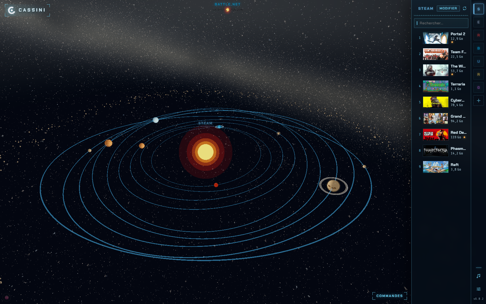
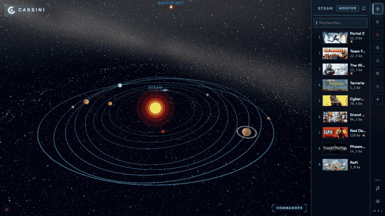
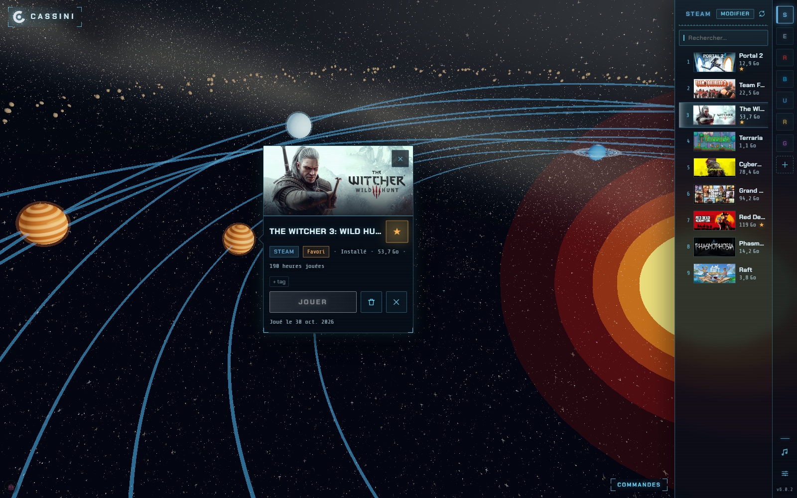
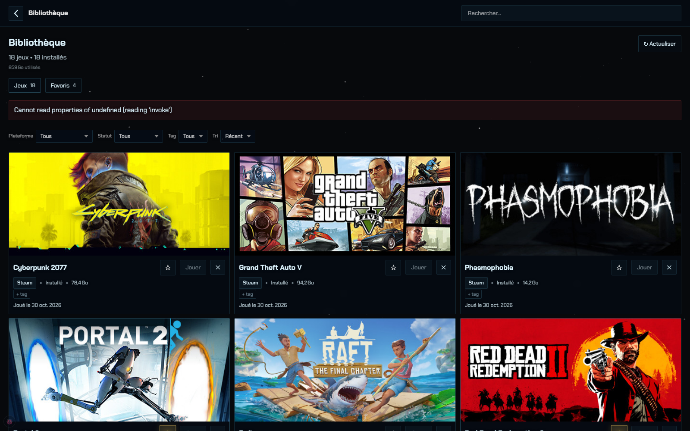
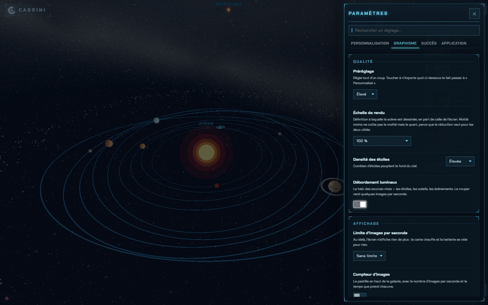
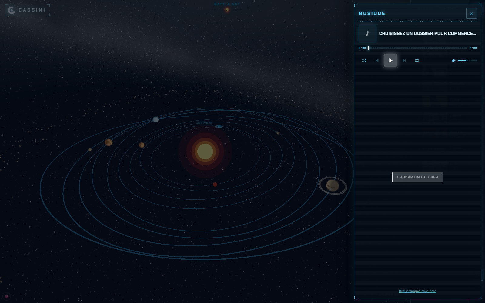

<div align="center">

# Cassini

**A game launcher for Windows that shows your library as a 3D galaxy.**

[](https://github.com/ap7816/Cassini/actions/workflows/ci.yml)
[](LICENSE)
[](https://tauri.app)
[](#download)

[Download](#download) · [Features](#features) · [Screenshots](#screenshots) · [Development](#development)



</div>

## What it is

Cassini finds the games installed on your PC across Steam, Epic, Battle.net, Ubisoft,
Riot, Rockstar, Xbox, HoYoPlay and Hytale, then puts them all in one place.

Instead of a grid, the main view is a galaxy. Each launcher is a solar system, each
game is a planet, and planet size follows how much disk space the game takes. Clicking
another launcher flies the camera there.

It's a native desktop app built with Tauri v2 (Rust) and React, not a web page in a
window.



## Features

- **Automatic scanning** of 9 launchers, with a file watcher that picks up installs
  and uninstalls without a manual refresh
- **Cover art** from the Steam CDN (computed from the AppID, no API key needed),
  SteamGridDB (optional key), or the game's own Windows icon as a fallback
- **Launch and uninstall** games directly, with the uninstaller named in the
  confirmation dialog when it isn't the game's own
- **Built-in music player** for MP3, FLAC, WAV, OGG, M4A and Opus, with recursive
  folder scanning, iTunes album art lookup, an equalizer, and a mini player that
  follows you across pages
- **Ambient soundtrack** and a living sky with auroras, shooting stars, comets,
  supernovas and black holes, all of which can be turned off
- **Auto-updates** through GitHub Releases
- **Custom systems** so you can group games your own way
- Favorites, tags, playtime, system tray, launch on startup, English and French

## Screenshots

|                                            |                                                  |
| :----------------------------------------: | :----------------------------------------------: |
|  |     |
|    Game details, opened over its planet    |      Library grid, for when you want a list      |
|       |  |
|                  Settings                  |                   Music player                   |

## Download

Windows 10 or 11. Grab the installer from the
[latest release](https://github.com/ap7816/Cassini/releases/latest). The app updates
itself after that.

> [!IMPORTANT]
> **If you are running 6.0.1 or earlier, you need to reinstall manually once.** Those
> builds sent an authorization header with every update check, and the credential
> behind it has since been revoked. GitHub answers 404 to a request carrying an
> invalid header, so those copies see no updates at all and say nothing about it.
> Download the installer above and run it over your existing install. Your library
> and settings are kept. From 6.0.2 on, no header is sent and updates work again.

## Development

### Requirements

- Node.js LTS
- Rust (via [rustup](https://rustup.rs))
- Visual Studio Build Tools 2022 with "Desktop development with C++", MSVC v143 and
  the Windows SDK
- WebView2, which ships with Windows 10 and 11

Run the commands below from "Developer PowerShell for VS 2022", otherwise the MSVC
linker won't be on your PATH.

### Setup

```bash
git clone https://github.com/ap7816/Cassini.git
```

```bash
cd Cassini; npm install; npm run tauri dev
```

### Scripts

| Command                                 | What it does                                               |
| --------------------------------------- | ---------------------------------------------------------- |
| `npm run tauri dev`                     | Run the full desktop app                                   |
| `npm run dev`                           | Run the frontend only, in a browser, without the Rust side |
| `npm run tauri build`                   | Build the release installer                                |
| `npm test`                              | TypeScript unit tests                                      |
| `npm run test:e2e`                      | End-to-end runs, recorded as video                         |
| `npm run test:rapport:tout`             | All three suites in one HTML report                        |
| `npm run captures`                      | Regenerate the screenshots in this README                  |
| `npm run typecheck` / `lint` / `format` | Types, linting, formatting                                 |

## Testing

261 tests in three suites, all run by [CI](.github/workflows/ci.yml) on every push.

| Suite      | Tests | Covers                                                                   |
| ---------- | ----- | ------------------------------------------------------------------------ |
| Vitest     | 204   | Library merging, storage, i18n, orbit geometry, camera paths             |
| Cargo      | 50    | Launcher scanners, registry reads, uninstaller matching, icon extraction |
| Playwright | 7     | Full user journeys through the running app                               |

The Playwright runs record a video and screenshots of each journey. They don't compare
pixels: a 3D render changes with the GPU and driver, so a test that failed over that
wouldn't tell you anything useful. The videos are there to watch, not to assert on.

They land in `.rapports/e2e/artefacts/`, one folder per journey, each with a
`video.webm` and the screenshots taken along the way. The folder name starts with a
dot, so File Explorer hides it unless you turn hidden items on. `npm run
test:rapport:tout` folds the same files into the HTML report, which is the easier way
to look at them.

The first run downloads a Chromium build of about 400 MB. `npm install` does not do
it, and recent npm versions block package install scripts anyway, so the npm scripts
run `playwright install chromium` themselves before the tests. It takes three seconds
once the browser is there.

Video recording is disabled on CI, where no GPU is available and reading frames back
from the software renderer took minutes per test. CI keeps Playwright traces for
failed runs instead, which you can replay with `npx playwright show-trace`.

## Project structure

```
src/
  pages/SolarSystem/   three.js scene, orbits, camera paths, textures
  features/            library, music, settings, achievements, sky events
  services/            Tauri bridge, with a browser fallback for dev
src-tauri/src/
  *_scan.rs            one module per launcher
  uninstall.rs         uninstaller lookup and its safety checks
  security.rs          what the frontend is allowed to ask the OS for
e2e/                   Playwright journeys
scripts/               test report and README screenshot generators
```

The frontend never touches the OS directly. Everything goes through Tauri commands,
and `security.rs` decides what's allowed. Music paths are confined to a root the user
picked, and an uninstall is refused if the registry entry points at something other
than the game you asked for.

Outside Tauri (`npm run dev`), the same code reads `localStorage` instead of the
native store. That's what lets the Playwright tests open a real galaxy in a plain
browser with a seeded library.

## Releasing

1. Bump the version in `package.json`, `src-tauri/tauri.conf.json` and
   `src-tauri/Cargo.toml`. The Tauri config is the one the updater reads.
2. Write the release notes in `src/features/patchNotes/changelog.ts`, in both
   languages.
3. Commit, then `git tag vX.Y.Z && git push origin vX.Y.Z`.

GitHub Actions builds the installer, signs it, and attaches all three pieces to the
release: the `.exe`, its signature, and the `latest.json` the updater reads. Takes
about 20 minutes.

Updates used to be served from a separate `ArcHive-updates` repo, which existed only
because this one was private. It isn't needed now, and the updater points here
instead.

## License

MIT, see [LICENSE](LICENSE). Bundled music and artwork have their own terms, listed in
[CREDITS.md](CREDITS.md).
